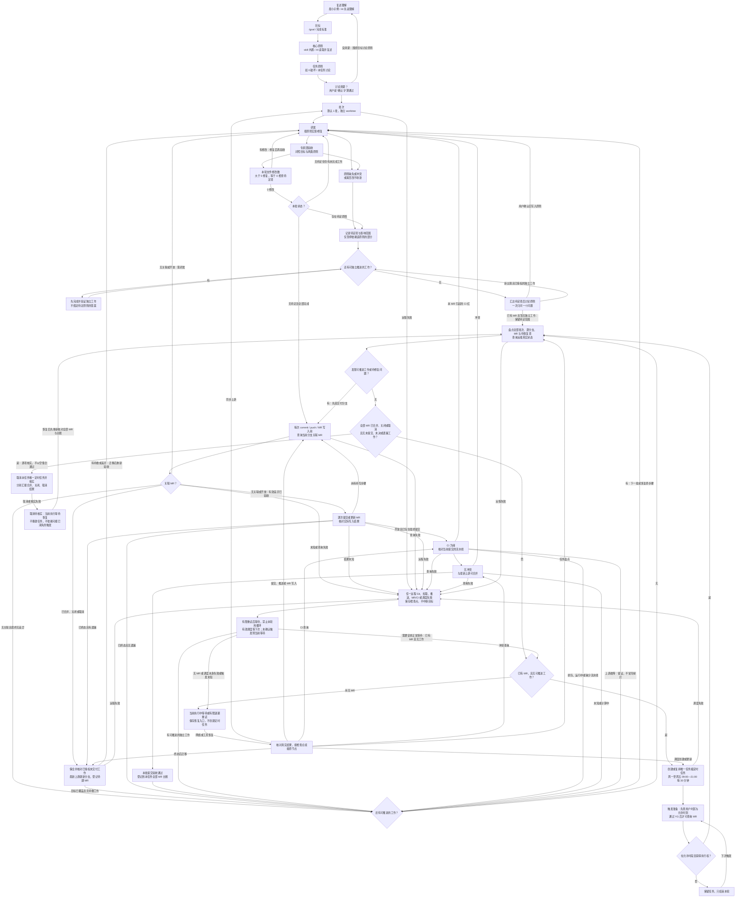

# 对齐交付

所有给用户看的话，都按 [references/explain-clearly.md](references/explain-clearly.md) 写：一句话结论 + 最小示例 + 能画就画，全程中文；删掉不影响用户判断的话，一次只问一个问题。

## 开始前先看两张图

能看图片就先打开这两张图；它们和下面的文字流程图内容一致，看不了图片时以文字流程图为准。

| 图 | 内容 |
|---|---|
| [assets/workflow.png](assets/workflow.png) | 完整工作流程 |
| [assets/mr-template.png](assets/mr-template.png) | MR 描述模板的结构 |

## 流程图（文字版，以此为准）

严格按下图的节点和走向执行，不跳步、不合并步骤。下文各节是每个节点的细则；文字与图有出入时，以图为准。



## 分工：谁定什么

| 谁 | 定什么 |
|---|---|
| 用户 | 目标、任务原则、新原则、开工 |
| AI | 原则之内的所有细节，并写明“依据原则 N” |

**确认**：只有用户明确说“确认”或“开始”才算。用户回答了问题、说“可以”“好的”、没有回复、AI 自己推荐了方案，都不算确认。初始目标与原则必须先确认；开工后出现新原则问题，按 Q–R 先推进不受影响的工作，受影响部分在确认前暂停。

## 状态文件

E（讨论清楚？）通过后，把目标、核心原则、任务原则、批次表写入状态文件；之后每批开始前、每轮验收前都先重读它：

```
$(git rev-parse --git-common-dir)/align-deliver/<分支名>.md
```

放在 git 目录内，不会被提交，上下文压缩后也不会丢。该文件是整个目标的台账，后续批次、定时运行都复用同一个任务标识与入口；不能只记录当前 MR。保存所有批次、源分支、MR 标识与远端状态、待恢复操作、定时任务标识及执行互斥信息，字段与恢复方式见 [references/mr-maintenance.md](references/mr-maintenance.md)。

每轮验收记录、新增原则和 MR 描述也写入台账。待定原则须记录影响范围、依赖、已完成独立工作及验证；每个远程写入前先保存意图，调用后保存已确认结果或“结果未知”。不得把凭据、令牌写入台账。

## A–E 对齐理解：围绕目标讨论原则

E（讨论清楚？）通过之前，不改任何代码；先完成不依赖目标选择的调查、取证和准备，再提出必须由用户决定的问题。

**需求和讨论，都只是围绕目标来讨论原则。** 对齐阶段的产出只有三样：目标、核心原则、任务原则。每次回复都只有这个形状：

```
目标：<一句话>
任务原则：
1. <原则>
2. <原则>
待确认：<本轮只问一个点>
```

- 不讨论细节（API 形状、改哪些文件、某个字段怎么处理）。细节由原则推出，进入 G 后 AI 自己决定，写进 MR 决策说明。
- 用户主动问到细节时：用最小示例简短回答，并写明“由原则 N 推出”；推不出来，说明缺一条原则，接下来讨论的是这条原则。
- 不给原则预设例外：原则说“全部”，就不先排除某几类、等用户追问才收回。

- **A 复述理解**：读相关代码，用最小示例说出你对目标的理解。
- **B 目标**：一句话目标 + 可验证的完成标准。用户用 `/goal` 设定过的，以原文为准。
- **C 核心原则**：读 [references/core-principles.md](references/core-principles.md)，按编号逐条复述。不讨论、不增删，只确认理解无偏差。
- **D 任务原则**：围绕目标，和用户讨论本任务专属的原则（如“业务逻辑 0 破坏”），编号列出。原则是裁决对错的标准，每条一句话；实现方式、待定的细节问题不是原则。
- **E 讨论清楚？**：把目标、核心原则、任务原则三项一次性列出，停下等用户说“确认”。没确认 → 回到 A 继续讨论，不开工。

## F 批次

每个任务在独立 worktree 中工作：E 通过后先同步上游，再新建独立 worktree 和分支，之后的研发、测试、提交都在这个 worktree 里完成。同步失败走 K，不能用过时缓存冒充最新上游；可先做不依赖最新代码的调查。

默认 1 批；任务大或风险高时才拆，先做简单、低风险的。批次 > 1 时用表格列出：批次 | 一句话 | 边界（含什么、不含什么）| 状态。相邻批次的边界不能重叠。

## G–I 研发 ⇄ 专家团验收（每批循环）

- **G 研发**：只做本批边界内的事，遵守核心原则与任务原则。维护已有 MR 时恢复该批的目标与原则，先经 J0 选定分支再修复，回 H 重新验收；不因维护顺手扩大范围。
- **H 专家团验收**：派出多位独立专家审查本批改动（能并行就并行，不能就依次换视角审查）。每位专家都对照目标、核心原则、任务原则逐条检查，发现问题可以直接修复。默认视角：
  - 原则合规：逐条对照编号原则，违反时写明“违反原则 N”
  - 正确性与回归：行为是否被意外改变
  - 范围：是否扩大需求、是否越层
  - 验证：lint、类型检查、测试是否通过
- **专家规则**：超出目标的发现只记为“范围外建议”写进 MR，不改文件。
- **I 本轮文件修改数**：统计本轮验收（含专家修复）改动的文件数。大于 0 → 回到 G 修复，再进行下一轮 H；等于 0 且本批没有待定原则或未完成工作 → 本批通过，进入 J0。仍有待定项时回到 Q–R，不能把独立部分完成当成整批完成，也不能删除未决范围来制造通过。
- **记录每一轮**：轮次 | 结论 | 修改文件数 | 证据等级（实测 / 读代码 / 推断），追加到状态文件。
- 用到 Chrome、模拟器、真机测试时，顺手截图，标注对应轮次（如“第 2 轮 · 模拟器”）。不是必须项。

## Q–R 按原则决策

- 研发和验收中遇到需要决定的事：符合核心原则与任务原则 → 自己决定，在 MR 决策说明里写明“依据原则 N”，不问用户。
- **Q 原则缺失或冲突**：现有原则推不出答案、两条原则互相冲突，或专家来回改不收敛时，记录待定项及其影响范围，只暂停依赖该原则的部分。按已确认目标与原则清点剩余工作，先完成并验证不依赖待定结论的部分，再汇总必须由用户决定的问题。不得自行假定答案、跨越依赖或扩大范围；没有可独立推进的工作时，立即进入 R。
- 最小示例：A 的要求明确，B 的权限原则待定，且二者独立 → 先完成并验证 A，再讨论 B；B 保持待定，整批不能算完成。
- **R 讨论原则**：独立工作完成并验证后，只问仍然阻塞任务的原则，不让用户选实现方案；多个待定项先汇总，一次只问一个问题。提问使用这个形状：

  ```
  已完成：<独立工作及验证结果；没有则如实说明>
  待定范围：<受影响的工作与依赖>
  冲突：原则 X「…」与原则 Y「…」（或：缺一条关于 … 的原则）
  最小示例：同一个输入，按 X 得到 …；按 Y 得到 …
  待确认：哪条优先？（或：补一条什么原则？）
  ```

  原则定下来后，实现方案由 AI 按原则推出。用户确认后，把新原则写入任务原则并标注“过程中新增”，更新待定状态，再回到 G 恢复受影响的工作；未确认时这些工作继续暂停，仍可推进新出现且已获授权的独立工作。未决项不算完成，也不能据此宣告整个任务已交付。
- 新原则只对后续工作生效；已合并的批次如需按新原则修改，作为新的一批加入批次表。尚未结束的 MR 若仍在原目标内，按确认后的原则继续维护；不把处理原 MR 的冲突另建为无关任务。

## J–N 提交验收：持续维护尚未结束的 MR

本批提交验收标准：MR 已提交、当前提交 CI 为绿、与最新上游无冲突。这只证明当时可合并；后续仍须追踪到远端确认已合并、关闭或取消。合并、关闭和取消由用户决定，不因维护自动执行。

- **J0–J2 选择交付分支**：每次 commit、push 或 MR 写入前核对当前分支历史关联，不只查开放列表；开放才续用原分支，未知走 K。终态后先保全工作，按目标实际内容（含压缩合并）排除已交付部分；仅把仍获授权的待做工作和有效差异转到最新上游的新独立分支，登记待建 MR 后回 G 重新验收。无差异且无待做工作不建空 MR，关闭/取消的范围不自动重做。迁移中断从检查点继续，复用已完成步骤。
- **J 提交 MR**：按 [references/mr-template.md](references/mr-template.md) 写自包含描述并核对引用。提交前按原则 9 检查文档和实际差异，任务临时产物移出提交范围后重新验收。逐次写入并核对结果；尚有待写步骤回 J0，不重复已确认操作。仅开放 MR 已含最终提交才进 L；写入期间若已终态，未覆盖工作回 J2，无遗漏回 O，未知或失败走 K。无关联且最终无差异时核销待建记录，不建空 MR。新 MR 创建前查重，成功即登记同一任务，不等 CI。
- **L CI 为绿**：核对当前 MR 提交对应的流水线。本 MR 引起的失败回 G；上游既有故障不扩大范围修复，留证并保持“阻塞/待恢复”，继续检查，不能冒充绿灯。排队、运行中、缺少流水线或查询失败都不能记为通过。
- **M 无冲突**：查询当前上游及可合并状态；冲突回 G，修复后经 H–T、J0–M 重新验证。状态未知或计算中则等待复查，不猜测。推送前再次核对 MR 仍开放及源分支远端提交，减少竞态；写入后再核对 MR 状态和目标内容是否覆盖本次有效改动，未覆盖的工作保留待交付，不能随 MR 终态丢弃。
- **N 本批提交验收通过**：将 MR 加入本任务台账，汇报“已提交、待处理”；随后先做 O 的可推进工作，不立即创建定时任务。

## K 远程失败：保存检查点，恢复后继续

任何远程 Git 操作（含 fetch / pull / push）、MR 或 CI 读写、调度操作都可能失败。失败只阻塞依赖它的部分，不终止整个目标，不丢弃本地改动，不把未知当成功。

每轮同一操作最多尝试 3 次并递增退避；仍失败则保存原步骤、预期结果、已确认状态和错误，先推进独立工作。有 MR 且再无可推进工作时进入 C0；尚无 MR 时保持待恢复，在当前执行中等待恢复并重新核对结果，不为此提前创建定时任务。不能将当前进程退出或宿主不可用描述成已安排自动恢复。

响应丢失、重启续跑、认证恢复及调度失败的处理见 [references/mr-maintenance.md](references/mr-maintenance.md)。需要用户恢复权限时明确报告，只暂停相关项，保留其他 MR 的维护；不得自行绕过权限。

## O–Z 盘点工作、定时维护与结束条件

- **O 有工作先做**：先补交/恢复可处理的操作，再推进其他批次和开放 MR 的修复；依赖上一批则堆叠分支，无依赖则基于最新上游。只有没有当前可推进的工作，才进入 V 盘点。
- **V / AA 盘点全部任务**：每次都重读整个台账，核对所有已提交 MR 与结果未知的写入。已合并、关闭或取消的 MR 记终态，有新授权工作或遗漏差异先走 J0；开放 MR 的修复也先经 J0 选分支。待原则确认的范围保持待定，其他 MR 照常检查，不重复催问同一问题。
- **AB 结束判定**：必须有非空、完整的 MR 集合，逐项确认都已合并、关闭或取消，且没有未提交批次、结果未知的写入、待恢复/待交付或待定工作。单个 MR 结束、仅查询开放 MR 得到空列表、读请求失败或台账完整性无法核实，都不能通过。关闭/取消须如实汇报，不能写成已合并或目标已实现。
- **AC / C0 创建时机**：已有本任务提交的 MR、没有可推进工作、尚未满足 AB 时，创建或复用**唯一任务级**定时任务，覆盖全部 MR；有工作时不新建。周一至周五按用户当前时区（默认宿主用户时区，本任务为 Asia/Singapore）09:00—21:00 每 30 分钟，包含 21:00、不含 21:30；周末不触发。记录任务标识与下一次执行时间，核实调度确已生效；无法调度则如实保持“待恢复”，不虚报监控成功。
- **Y 每次触发**：先检查用户时区和允许时刻，再获取任务级互斥、重读台账，回 V；定时误触发在时段外或未取得执行权时保留任务并仅结束本轮；恢复或修复共用原状态，按 J0 选择分支；新 MR 加入同一任务，不另建调度。新增工作出现时执行它，已有定时任务保留但不并发修改；本轮未完成的内容保存检查点，下一轮续接。不因本轮无变化或网络失败取消任务。
- **Z 取消与汇报**：AB 通过后，进入独立的收尾阶段，取消唯一任务级定时任务并核实结果；取消失败进入 ZF，当前执行等待恢复，不依赖可能已经消失的触发。恢复先回 V 重新核对全部 MR 与台账；真正取消前后也须重验结束条件。若出现开放 MR 或新工作，撤销收尾回 O/V；已取消则在再次满足 C0 时恢复唯一任务。只有业务终态仍成立时才核实/续接取消，不重复创建正常维护任务。取消待核实是控制状态，不单独算作业务未完成；业务核实结果仍须新鲜，未核实取消前不能记维护已结束。汇报表：批次 | 一句话 | MR 链接 | 状态，分别统计合并、关闭、取消与仍待处理项。已启动的任务只有所有 MR 达到终态且无遗漏工作，才能结束维护。

调度入口、互斥、每轮动作与恢复示例详见 [references/mr-maintenance.md](references/mr-maintenance.md)。
