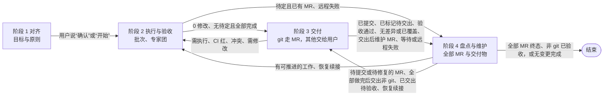

# 对齐交付

所有给用户看的话，都按 [references/explain-clearly.md](references/explain-clearly.md) 写：一句话结论 + 最小示例 + 能画就画，全程中文；删掉不影响用户判断的话，一次只问一个问题。

## 四个阶段

适用于任何工作，不只是研发。只有提交到 git 的内容走 MR；其他交付物不按批次停下等验收，全部工作做完后一次交给用户，用户验收通过才结束。

| 阶段 | 节点 | 细则与流程图 | 结束条件 |
|---|---|---|---|
| 1 对齐 | A、B、C、D、E | [references/phase-1-align.md](references/phase-1-align.md) | 用户说“确认”或“开始” |
| 2 执行与验收 | F、G、H、I、T、Q、S、W、U、R | [references/phase-2-execute.md](references/phase-2-execute.md) | 本批 0 修改、无待定原则且全部完成 |
| 3 交付 | DT、UA、UV、J0、J1、J2、J、L、M、N | [references/phase-3-deliver.md](references/phase-3-deliver.md) | git：MR 提交验收通过（CI 为绿、无冲突），CI 或冲突未决时转阶段 4 等待复查；非 git：本批标记待交出；全部做完后一次交出，用户验收通过 |
| 4 盘点与维护 | O、V、AA、AB、AC、C0、Y、YG、Y0、X、D0、RT、K、K0、Z、ZF、END | [references/phase-4-maintain.md](references/phase-4-maintain.md) | 全部 MR 终态、非 git 交付物已验收，且无遗漏工作 |

总图只画阶段之间的关系；具体节点和走向以各阶段文件的 mermaid 流程图为准，四个阶段的流程图合起来就是完整流程。进入某个阶段时，先读该阶段的文件，再按文件里的流程图执行。能看图片时，先打开总图 [assets/flow-overview.png](assets/flow-overview.png) 和当前阶段的图；交付说明的结构见 [assets/delivery-template.png](assets/delivery-template.png)。

## 分工：谁定什么

| 谁 | 定什么 |
|---|---|
| 用户 | 目标、任务原则、新原则、开工 |
| AI | 原则之内的所有细节，并写明“依据原则 N” |

**确认**：只有用户明确说“确认”或“开始”才算。用户回答了问题、说“可以”“好的”、没有回复、AI 自己推荐了方案，都不算确认。初始目标与原则必须先确认；开工后出现新原则问题，按 Q–R 先推进不受影响的工作，受影响部分在确认前暂停。

## 续跑

执行中的关键状态要能在上下文压缩、重启或新一次定时触发后读回；记在哪里、用什么格式由 agent 决定，不放进交付物或提交范围（原则 9）。E 通过后即开始保存；之后每批开始前、每轮验收前、每次续跑或定时触发时，先读回已保存的状态再继续。需要保存哪些状态，见 [references/phase-4-maintain.md](references/phase-4-maintain.md) 的「续跑不丢状态」。
