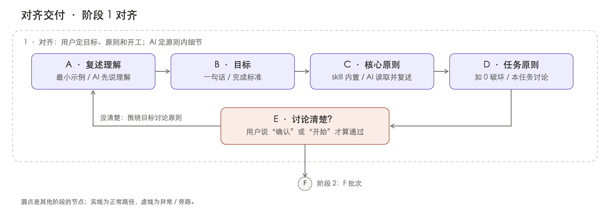
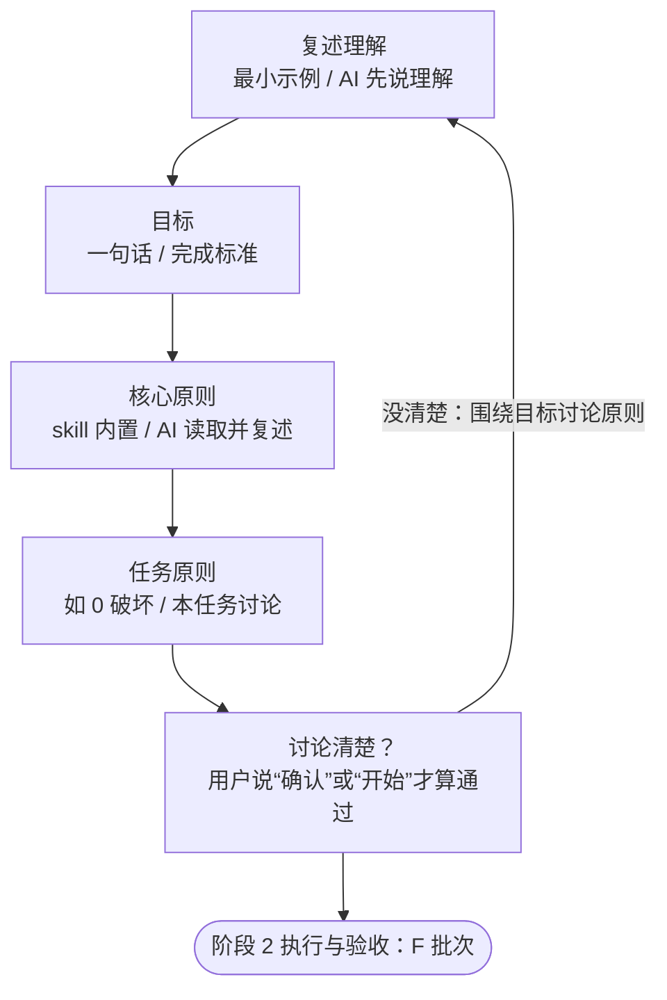

# 阶段 1 对齐：围绕目标讨论原则

**入口**（从其他阶段进入本阶段）：

- 无

**出口**（离开本阶段）：

- E → F：阶段 2 执行与验收

本文件的 mermaid 流程图为准；图片按它绘制，仅供查看，看不了图片时直接按 mermaid 执行。严格按图的节点和走向执行，不跳步、不合并步骤；圆角节点在其他阶段文件中，圆形节点表示整个流程结束。文字与图有出入时，以图为准。





E（讨论清楚？）通过之前，不改任何交付内容；先完成不依赖目标选择的调查、取证和准备，再提出必须由用户决定的问题。

**需求和讨论，都只是围绕目标来讨论原则。** 对齐阶段的产出只有三样：目标、核心原则、任务原则。每次回复都只有这个形状：

```
目标：<一句话>
任务原则：
1. <原则>
2. <原则>
待确认：<本轮只问一个点>
```

- 不讨论细节（API 形状、改哪些文件、某个字段怎么处理；文档类如章节结构、某个数据的口径）。细节由原则推出，进入 G 后 AI 自己决定，写进交付说明的决策说明。
- 用户主动问到细节时：用最小示例简短回答，并写明“由原则 N 推出”；推不出来，说明缺一条原则，接下来讨论的是这条原则。
- 不给原则预设例外：原则说“全部”，就不先排除某几类、等用户追问才收回。

- **A 复述理解**：读相关代码或资料，用最小示例说出你对目标的理解。
- **B 目标**：一句话目标 + 可验证的完成标准。用户事先设定过目标的，以原文为准。
- **C 核心原则**：读 [core-principles.md](core-principles.md)，按编号逐条复述。不讨论、不增删，只确认理解无偏差。
- **D 任务原则**：围绕目标，和用户讨论本任务专属的原则（如“业务逻辑 0 破坏”），编号列出。原则是裁决对错的标准，每条一句话；实现方式、待定的细节问题不是原则。
- **E 讨论清楚？**：把目标、核心原则、任务原则三项一次性列出，停下等用户说“确认”或“开始”。没确认 → 回到 A 继续讨论，不开工。
