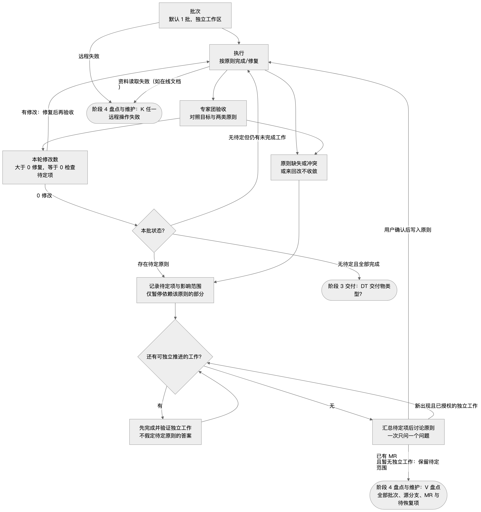
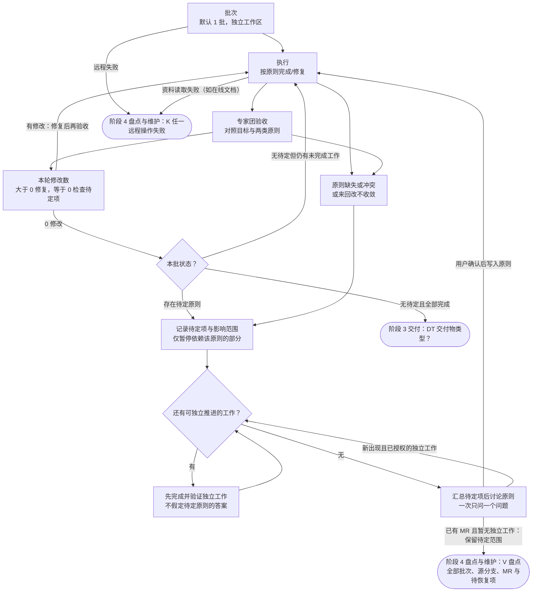

# 阶段 2 执行与验收

**入口**（从其他阶段进入本阶段）：

- E → F：阶段 1 对齐
- J1 → G（无关联或开放：需执行）：阶段 3 交付
- J2 → G（有待做或差异：迁移后重新验收）：阶段 3 交付
- O → G（有：下一批或恢复原步骤）：阶段 4 盘点与维护
- RT → F（同步上游）：阶段 4 盘点与维护
- L → G（本 MR 引起的 CI 红）：阶段 3 交付
- M → G（冲突）：阶段 3 交付
- UV → G（需修改：回执行）：阶段 3 交付
- RT → G（资料读取（如在线文档））：阶段 4 盘点与维护

**出口**（离开本阶段）：

- T → DT（无待定且全部完成）：阶段 3 交付
- F → K（远程失败）：阶段 4 盘点与维护
- R → V（已有 MR 且暂无独立工作：保留待定范围）：阶段 4 盘点与维护
- G → K（资料读取失败（如在线文档））：阶段 4 盘点与维护

本文件的 mermaid 流程图为准；图片由它渲染，仅供查看，看不了图片时直接按 mermaid 执行。严格按图的节点和走向执行，不跳步、不合并步骤；圆角节点在其他阶段文件中，圆形节点表示整个流程结束。文字与图有出入时，以图为准。





## F 批次

每个任务在独立工作区中工作：git 内容用独立 worktree；非 git 交付物在独立的工作副本中起草（不放进任何 git 工作树，含本任务 worktree，避免误提交；交出的是成品，不含过程记录）。有 git 内容时：E 通过后先同步上游，再新建独立 worktree 和分支，之后的执行、检查、提交都在这个 worktree 里完成。同步失败走 K，不能用过时缓存冒充最新上游；可先做不依赖最新代码的调查。

默认 1 批；任务大或风险高时才拆，先做简单、低风险的。批次 > 1 时用表格列出：批次 | 一句话 | 边界（含什么、不含什么）| 状态。相邻批次的边界不能重叠。

## G–I 执行 ⇄ 专家团验收（每批循环）

- **G 执行**：只做本批边界内的事，遵守核心原则与任务原则。维护已有 MR 时恢复该批的目标与原则，在该 MR 的分支上修复（每次提交、推送前仍经 J0 核对），修复后回 H 重新验收；不因维护顺手扩大范围。
- **H 专家团验收**：派出多位独立专家审查本批产出（能并行就并行，不能就依次换视角审查）。每位专家都对照目标、核心原则、任务原则逐条检查，发现问题可以直接修复。默认视角：
  - 原则合规：逐条对照编号原则，违反时写明“违反原则 N”
  - 正确性与回归：行为或已有内容是否被意外改变
  - 范围：是否扩大需求、是否越层
  - 验证：自动检查（如 lint、类型检查、测试；文档类如事实与数据核对）是否通过
- **专家规则**：超出目标的发现只记为“范围外建议”写进交付说明（git 即 MR 描述），不改文件。
- **I 本轮修改数**：统计本轮验收（含专家修复）的修改数：git 计改动的文件数，其他交付物计修改处。大于 0 → 回到 G 修复，再进行下一轮 H；等于 0 且本批没有待定原则或未完成工作 → 本批通过，进入阶段 3 的 DT。仍有待定项时回到 Q–R，不能把独立部分完成当成整批完成，也不能删除未决范围来制造通过。
- **记录每一轮**：轮次 | 结论 | 修改数 | 证据等级（实测 / 读代码或资料 / 推断）。
- 用到浏览器、模拟器、真机等实测时，顺手截图，标注对应轮次（如“第 2 轮 · 模拟器”）。不是必须项。

## Q–R 按原则决策

- 执行和验收中遇到需要决定的事：符合核心原则与任务原则 → 自己决定，在交付说明的决策说明里写明“依据原则 N”，不问用户。
- **Q 原则缺失或冲突**：现有原则推不出答案、两条原则互相冲突，或专家来回改不收敛时，记录待定项及其影响范围，只暂停依赖该原则的部分。按已确认目标与原则清点剩余工作，先完成并验证不依赖待定结论的部分，再汇总必须由用户决定的问题。不得自行假定答案、跨越依赖或扩大范围；没有可独立推进的工作时，立即进入 R。
- 最小示例：A 的要求明确，B 的权限原则待定，且二者独立 → 先完成并验证 A，再讨论 B；B 保持待定，整批不能算完成。
- **R 讨论原则**：独立工作完成并验证后，只问仍然阻塞任务的原则，不让用户选实现方案；多个待定项先汇总，一次只问一个问题。提问使用这个形状：

  ```
  已完成：<独立工作及验证结果；没有则如实说明>
  待定范围：<受影响的工作与依赖>
  冲突：原则 X「…」与原则 Y「…」（或：缺一条关于 … 的原则）
  最小示例：同一个输入，按 X 得到 …；按 Y 得到 …
  待确认：哪条优先？（或：补一条什么原则？）
  ```

  原则定下来后，实现方案由 AI 按原则推出。用户确认后，把新原则写入任务原则并标注“过程中新增”，更新待定状态，再回到 G 恢复受影响的工作；未确认时这些工作继续暂停，仍可推进新出现且已获授权的独立工作。未决项不算完成，也不能据此宣告整个任务已交付。
- 新原则只对后续工作生效；已合并或已验收的批次如需按新原则修改，作为新的一批加入批次表；已标记为“待交出”但尚未交出的非 git 批次属于未交付工作，按新原则继续修改。尚未结束的 MR 若仍在原目标内，按确认后的原则继续维护；不把处理原 MR 的冲突另建为无关任务。
