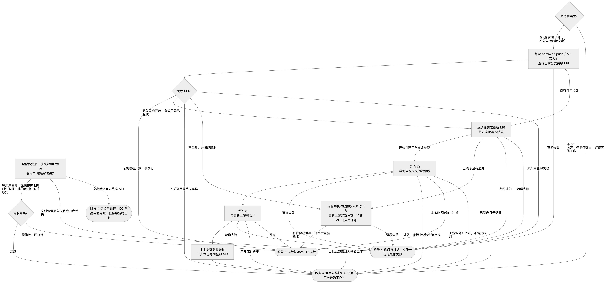
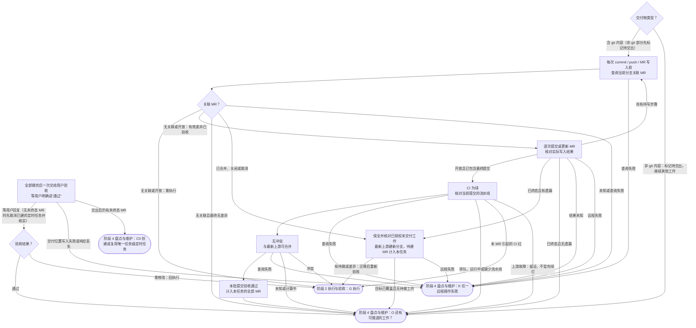

# 阶段 3 交付

**入口**（从其他阶段进入本阶段）：

- T → DT（无待定且全部完成）：阶段 2 执行与验收
- AA → J0（有：先选交付分支）：阶段 4 盘点与维护
- RT → J0（提交、推送或 MR 写入）：阶段 4 盘点与维护
- RT → J2（终态后迁移）：阶段 4 盘点与维护
- RT → L（CI 查询）：阶段 4 盘点与维护
- RT → M（冲突查询）：阶段 4 盘点与维护
- AC → UA（② 有待交出的非 git 交付物，且无待定、待恢复或未提交工作）：阶段 4 盘点与维护
- AC → UV（③ 无未终态 MR、无待恢复项，只等已交出的非 git 验收：先取消已建的定时任务并核实，再停下等用户）：阶段 4 盘点与维护
- RT → UA（交付位置写入（如在线文档））：阶段 4 盘点与维护

**出口**（离开本阶段）：

- J1 → G（无关联或开放：需执行）：阶段 2 执行与验收
- J1 → O（无关联且最终无差异）：阶段 4 盘点与维护
- J1 → K（未知或查询失败）：阶段 4 盘点与维护
- J2 → G（有待做或差异：迁移后重新验收）：阶段 2 执行与验收
- J2 → O（目标已覆盖且无待做工作）：阶段 4 盘点与维护
- J2 → K（远程失败）：阶段 4 盘点与维护
- J → O（已终态且无遗漏）：阶段 4 盘点与维护
- J → K（结果未知）：阶段 4 盘点与维护
- N → O：阶段 4 盘点与维护
- J0 → K（查询失败）：阶段 4 盘点与维护
- J → K（远程失败）：阶段 4 盘点与维护
- L → K（查询失败）：阶段 4 盘点与维护
- M → K（查询失败）：阶段 4 盘点与维护
- L → O（排队、运行中或缺少流水线）：阶段 4 盘点与维护
- M → O（未知或计算中）：阶段 4 盘点与维护
- L → G（本 MR 引起的 CI 红）：阶段 2 执行与验收
- L → O（上游故障：留证，不冒充绿灯）：阶段 4 盘点与维护
- M → G（冲突）：阶段 2 执行与验收
- DT → O（非 git 内容：标记待交出，继续其他工作）：阶段 4 盘点与维护
- UV → O（通过）：阶段 4 盘点与维护
- UV → G（需修改：回执行）：阶段 2 执行与验收
- UA → K（交付位置写入失败或响应丢失）：阶段 4 盘点与维护
- UA → C0（交出后仍有未终态 MR）：阶段 4 盘点与维护

本文件的 mermaid 流程图为准；图片由它渲染，仅供查看，看不了图片时直接按 mermaid 执行。严格按图的节点和走向执行，不跳步、不合并步骤；圆角节点在其他阶段文件中，圆形节点表示整个流程结束。文字与图有出入时，以图为准。

## DT–UV 按交付物类型交付

- **DT 交付物类型**：本批产出提交到 git 仓库 → J0，走 MR；其他产出（文档、方案、表格、演示等）不按批次停下等验收，在本任务已保存的状态中标记为“待交出”（不改动交付物本身）后进入 O，继续其他工作。一批同时有两类时，先把非 git 部分标记为“待交出”，再走 git 路径。所有工作做完、没有可推进的工作时，经 AC 进入 UA，把全部非 git 交付物一次交给用户。
- **UA 全部做完后一次交给用户验收**：按 [delivery-template.md](delivery-template.md) 写交付说明，放在给用户的回复或消息里，不写进交付物正文（原则 9）；连同交付物（或其位置）交给用户，标记为“已交出待验收”，等用户明确说“通过”。写入用户指定的交付位置后，先读回该位置，核对内容与专家团验收到 0 修改的版本一致再交出；读回不一致或只写入了一部分时，以该版本为准，只修正差异部分，不整段追加。写入失败或响应丢失走 K。仍有未终态 MR 时，交出后走 UA→C0 维护 MR，等待验收不阻塞 MR 维护；没有未终态 MR 时，之前建过定时任务的先按 AC ③ 的方式取消并核实，再停下等用户回复。用户回复“好的”、没有回复，都不算通过。非 git 交付物没有远端状态可查，不建定时任务。用户指定了交付位置时，按用户要求写入该位置。
- **UV 验收结果**：用户说“通过” → 标记为“已验收”，进入 O；用户提出修改 → 回到 G，修改后重新经 H 验收至 0 修改，再回 DT 标记为“待交出”，全部做完后再次一次交出。修改涉及原则缺失或冲突时走 Q–R。

## J–N 提交验收：持续维护尚未结束的 MR

本批提交验收标准：MR 已提交、当前提交 CI 为绿、与最新上游无冲突。这只证明当时可合并；后续仍须追踪到远端确认已合并、关闭或取消。合并、关闭和取消由用户决定，不因维护自动执行。

- **J0–J2 选择交付分支**：每次 commit、push 或 MR 写入前核对当前分支历史关联，不只查开放列表；开放才续用原分支，未知走 K。终态后先保全工作，按目标实际内容（含压缩合并）排除已交付部分；仅把仍获授权的待做工作和有效差异转到最新上游的新独立分支，把待建 MR 计入本任务后回 G 重新验收。无差异且无待做工作不建空 MR，关闭/取消的范围不自动重做。迁移中断从检查点继续，复用已完成步骤。
- **J 提交 MR**：按 [delivery-template.md](delivery-template.md) 写自包含描述并核对引用。提交前按原则 9 检查文档和实际差异，任务临时产物移出提交范围后重新验收。逐次写入并核对结果；尚有待写步骤回 J0，不重复已确认操作。仅开放 MR 已含最终提交才进 L；写入期间若已终态，未覆盖工作回 J2，无遗漏回 O，未知或失败走 K。无关联且最终无差异时核销该待建 MR，不建空 MR。新 MR 创建前查重，成功即计入本任务，不等 CI。
- **L CI 为绿**：核对当前 MR 提交对应的流水线。本 MR 引起的失败回 G；上游既有故障不扩大范围修复，留证并保持“阻塞/待恢复”，继续检查，不能冒充绿灯。排队、运行中、缺少流水线或查询失败都不能记为通过。
- **M 无冲突**：查询当前上游及可合并状态；冲突回 G，修复后经 H–T、J0–M 重新验证。状态未知或计算中则等待复查，不猜测。推送前再次核对 MR 仍开放及源分支远端提交，减少竞态；写入后再核对 MR 状态和目标内容是否覆盖本次有效改动，未覆盖的工作保留待交付，不能随 MR 终态丢弃。
- **N 本批提交验收通过**：将 MR 计入本任务，汇报“已提交、待处理”；随后先做 O 的可推进工作，不立即创建定时任务。
